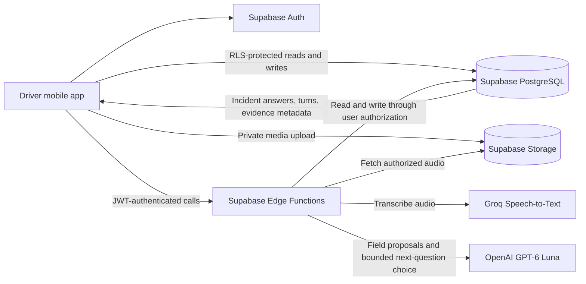
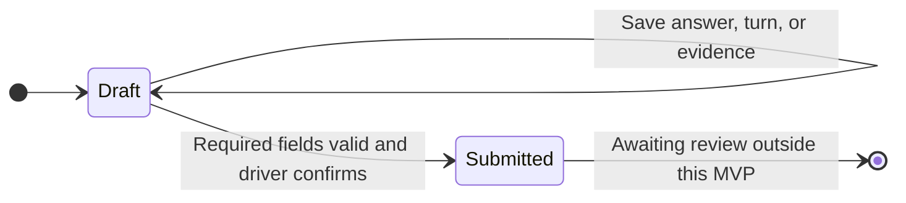

# JebelDAL MVP Technical Architecture

**Scope:** A functional, driver-only voice-first incident-reporting MVP for four engineers. Day 1 delivers the core flow end to end; Day 2 is demo-ready; Day 3 is reserved for polish, optional stories, and rehearsal. The architecture prioritizes a reliable report-to-submission workflow, not scale.
**Updated:** 2026-11-18

> **Product goal:** Let a driver explain an incident naturally, have the app capture and organize the facts, ask for missing information, collect evidence, and present an editable report for confirmation and submission for review.

## 1. Product scope and success criteria

### Primary workflow

1. An invited driver signs in, completes the required profile step, and starts a report.
2. The app creates a draft and fills driver, truck, report time, and available location data from trusted sources.
3. The interview starts with “What happened?” The driver records a voice answer or types it; audio is saved to private Storage.
4. Groq transcribes the recording; OpenAI proposes structured values from the narrative. The driver can correct the transcript and accept, edit, or reject each proposal.
5. Deterministic rules identify eligible questions in the 38-node graph and its 17 branch conditions; AI recommends the next question from that allowed set, with no fixed question cap.
6. After Witnesses, the driver confirms driver/truck/time/location, then captures or attaches evidence when applicable.
7. The driver reviews all applicable forms and evidence, confirms with biometrics or device passcode, and submits once.
8. The report is shown as “Submitted · awaiting review”; no manager queue, approval, or change-request workflow is included in this driver-only MVP.
9. The driver can resume a saved draft or view submitted forms and their status.

### MVP scope

- Support three demo forms based on trimmed ACORD 2/3/4 fields: Auto, General Liability, and Workers' Comp. These are demo forms, not authoritative carrier forms.
- Render every mockup field label through shared form definitions. Target at least 80% of the data fields (at least `ceil(totalDataFields * 0.8)` based on the completed definitions) with the correct input type, save/edit behavior, basic validation, applicable visibility/required rules, and review display. All remaining fields must still appear in the right section and be editable using a safe generic text control; do not silently omit them.
- Implement all 38 interview question nodes and 17 branch conditions, with the three representative paths exercised end to end: Auto, Auto + property/GL, and injury/WC.
- Prioritize Must stories for a complete driver flow by Day 2. Day 3 Should/Could stories are optional polish/bonus work and must not jeopardize the core voice-to-submit workflow.
- Represent all in-app mockup areas, but implement optional setup, language, and bonus surfaces at the workbook priority rather than treating every screen as a Day 2 Must.
- Provide editable transcript, text fallback, field-level confirmation/correction, audio/photo evidence upload, local draft recovery, final detail confirmation, review/signature, and submission. A short video is a Day 3 Could.
- English is required for the MVP. Spanish interview questions/transcription are a Day 3 Could.
- Prefill from seeded organization, profile, policy, vehicle, and trip records; use seeded Home trip/score/pre-trip content rather than presenting it as live fleet data.
- Only profile completion gates filing. Biometrics are a Day 2 Should; documents, walk-around photos, and the Files screen are Day 3 Could setup features.
- Use fictional data only. Form definitions based on mockups are not authoritative claim forms and must not be used for actual claims.

### Mockup coverage matrix

| Mockup screen/area | Coverage | MVP behavior | Boundary |
|---|---|---|---|
| Log in | Must — Day 1 | Supabase email/password sign-in, session persistence, password reset, and invited-driver-only access. | No self-signup. |
| Profile | Must — Day 1 | Confirm/edit roster-backed driver details and complete the required onboarding step. | Seeded demo driver; no identity-document verification. |
| Facial recognition / biometric setup | Should — Day 2 | Offer device biometric enrollment; skip or use device passcode when unsupported. | OS-local authentication only; no biometric data is uploaded. |
| Drop documents | Could — Day 3 | Upload CDL, DOT medical card, cab card/registration, and insurance card to private Storage. | No OCR or expiry alerts; setup can be skipped. |
| Truck walk-around | Could — Day 3 | Capture front, driver-side, rear, and passenger-side photos with timestamp, optional GPS, and vehicle ID. | Upload only; no AI damage assessment. |
| Home | Must — Day 1 | Show one-tap report action, seeded trip/score/pre-trip display data, profile greeting, and bottom navigation. | Demo/seeded data, not a live fleet integration. |
| Files | Could — Day 3 | Browse Documents/Photos; show seeded document summaries and uploaded walk-around/incident photos. | No OCR or external document repository. |
| Incidents | Must — Day 1/2 | Create reports and list the driver's own drafts/submissions with applicable forms, status, vehicle, location, and summary. | Submitted status is “Submitted · awaiting review”; no manager approval flow. |
| Interview | Must — Day 1/2 | Voice/text and tap answers, waveform while recording, transcript after stop, replay, back/skip, progress, quick replies, and the 38-node/17-branch graph. | English required; Spanish is a Day 3 Could. No live streaming transcript. |
| Confirm details | Must — Day 2 | After Witnesses, review/edit driver, truck, time, and GPS location; show map and location accuracy when available. | Manual correction remains available; GPS is not required. |
| Photos & videos | Photos Must — Day 2; video Could — Day 3 | Show a shot list based on incident answers and capture/select photos. Optional video is limited to 30 seconds. | Standard camera only; optional post-capture photo check is Day 3 Should; videos are not analyzed. |
| Truck damage diagram | 2D Must — Day 2; 3D Should — Day 3 | Let the driver select damage zones from a truck diagram; both views save the same zone list. | 3D requires a licensed model and falls back to 2D if it fails to load. |
| Review & sign | Must — Day 2 | Edit answers, inspect evidence and source labels, confirm using biometrics/device passcode, stamp driver name/time/device, and submit once. | No manager review screen or drawn-signature workflow. |
| Carrier forms / submitted report | Must review; read-only view Should — Day 3 | Render the triggered Auto/GL/WC forms before submit; optionally provide a read-only submitted copy after success. | PDF export is only if time permits; forms are not legally authoritative. |

Represent all in-app mockup areas, with priorities and dates from the workbook. Core Must stories must work by the end of Day 2; Should/Could stories are stretch scope. Coverage of forms is measured against the data fields in the completed definitions. Target at least 80% of all defined fields with typed, persisted, validated, reviewable behavior. Count each declared scalar field once, including repeatable-group children; do not count section headings, screenshots, or label-only controls as functional coverage.

The interview, three form definitions, report detail confirmation, incident photos, review/signature, and submit flow are mandatory. Use seeded display data for Home metrics and make no claim that these are live fleet signals.

### Not included

Manager/supervisor screens and approval/change-request workflow, server-side face recognition, document OCR/expiry alerts, video analysis, fleet/ERP/insurer integrations, full offline operation, provider failover, push notifications, and production-scale infrastructure. Optional Day 3 photo checks, Spanish, 3D truck view, and seeded-form expansion are stretch work, not core requirements.

### Acceptance criteria

- A saved draft and completed turns remain available after closing and reopening the app.
- A voice answer produces a visible transcript and field suggestions; a text answer works without the speech provider.
- AI output never overwrites a driver-confirmed answer or invents an unknown fact.
- Required and conditional fields are calculated by application rules; unanswered requirements block submission with clear field-level messages.
- The driver can inspect and edit every answer and evidence item before signing/submitting.
- Submission creates exactly one report with status “Submitted · awaiting review”; no in-app manager decision is part of this MVP.
- A provider, network, or upload failure is visible and does not erase the draft or previously saved answers.
- Every mockup field/section label appears in the correct form; at least 80% of data fields pass typed-input, save/reopen, edit, validation, conditional-visibility, and review checks.
- All Day 1/Day 2 Must stories in the coverage matrix pass their listed interaction checks; lower-priority stories are not required for the core demo.
- The full 38-node question graph supports its skip/back/progress behavior and all configured branches. AI selects only from eligible questions; invalid/unavailable planning uses a visible deterministic fallback.
- A 30-second audio clip targets a visible transcript within three seconds; measure on physical devices and show progress/retry if provider latency exceeds the target.

## 2. Technology decisions

| Area | MVP decision | Implementation notes |
|---|---|---|
| Mobile | Expo + React Native + TypeScript | iOS/Android app; test recording and camera permissions on a physical device. |
| Backend | Supabase | Auth, PostgreSQL, private Storage, and Edge Functions; no separate API server. |
| Authentication | Supabase Auth | Email/password for the MVP. Face ID/biometrics, if used, only unlock an existing local session. |
| Database | Supabase PostgreSQL | Canonical store for incidents, turns, answers, evidence metadata, and review decisions. |
| File storage | Private Supabase Storage | Audio, incident photos/videos, profile documents, and walk-around photos; only signed-in authorized access. |
| Transcription | Groq Speech-to-Text | Called by an Edge Function; provider key never ships in the app. |
| Extraction and question planning | OpenAI Responses API with configured GPT-6 Luna model ID | Structured field proposals and a next-question recommendation selected only from server-provided eligible questions; the server validates both. |
| Secrets management | Infisical | Source of truth for environment-specific provider credentials; inject secrets only into trusted server-side runtimes. |
| Form definitions | Versioned JSON in Supabase PostgreSQL, seeded from checked-in files | Base definitions and question graph are seeded; no admin UI. Day 3 stretch work can demonstrate adding a form definition through a seed script. |
| Context enrichment | Open-Meteo plus sunrise/sunset calculation | Day 2 Should; use only for weather/daylight prefill, label its source, and allow driver correction. |
| Validation | Shared TypeScript schemas plus server-side deterministic checks | AI output is untrusted; form rules decide completeness and allowed state transitions. |

Supabase remains the application backend; it does not need to host the AI models. Groq/OpenAI API usage is billed separately. Verify project secrets, model access, provider account limits, and supported audio format before implementation. The workbook is the current story/prioritization source: [JebelAI_User_Stories (1).xlsx](./JebelAI_User_Stories%20(1).xlsx).

## 3. System architecture



PostgreSQL is the source of truth for report state. Storage holds media bytes; database rows hold ownership, object paths, type, upload state, and incident relationships. Provider responses are proposals, not business state.

## 4. Application modules

Keep the code in one mobile app and a small set of Edge Functions. Separate responsibilities by module without introducing microservices.

| Module | Responsibility |
|---|---|
| Identity/profile | Invited-driver sign-in, profile completion, organization membership, assigned vehicle and locale; optional device-local biometric unlock. |
| Home/files | Show seeded trip/score/pre-trip content and incident shortcuts; Day 3 stretch work includes browsing uploaded profile documents and vehicle photos. |
| Incident workspace | Create/resume drafts and show the driver's draft/submitted lists and report-card summaries. |
| Form renderer | Render typed controls and labels from versioned form definitions; support repeated groups; show required/conditional state, source labels, and validation messages. |
| Conversation | Record/type answers, persist turns, display/edit transcript, replay prompts, accept/correct suggestions, support back/skip/progress, and ask the AI to choose the next question from the rule-validated eligible set. |
| Evidence | Upload incident audio/photos to private Storage, generate a shot list from confirmed incident facts, and show upload/retry state; optional Day 3 work adds video, walk-around photos, and post-capture photo checks. |
| Review/signature | Display complete report, allow edits, confirm with device biometric/passcode, stamp driver name/time/device, and submit. |
| Edge Functions | Authorize driver-owned operations, call providers, validate structured output, and enforce submission rules and idempotency. |

## 5. Incident and conversation lifecycle

### Incident status

Use explicit transitions:



After submission, lock the report and preserve its submitted snapshot. The driver-facing MVP does not implement reviewer decisions, change requests, or post-submission editing.

### Conversation turn status

Each user answer is a durable turn with `received`, `processing`, `completed`, or `failed` status. The client generates a UUID `client_turn_id` once and reuses it on retries. Enforce uniqueness per incident revision so a network retry does not create duplicate turns.

The app must save the turn and audio object reference before calling AI. On return to an interrupted report, fetch the incident and turns, display completed answers, and offer retry for a failed/incomplete turn. Do not assume a timed-out client request failed on the server; retry with the same turn ID and return the stored result if already completed.

## 6. Form engine

Keep field definitions data-driven, but use a small allowlisted rule language. Do not put executable code or arbitrary expressions in form JSON.

Example shape:

```ts
type FieldDefinition = {
  key: string;
  section: string;
  type:
    | "text"
    | "long_text"
    | "boolean"
    | "number"
    | "currency"
    | "date"
    | "datetime"
    | "enum"
    | "multi_enum"
    | "phone"
    | "email"
    | "address"
    | "media"
    | "repeated_group";
  label: { en: string; es: string };
  question?: { en: string; es: string };
  requiredWhen?: Condition;
  visibleWhen?: Condition;
  options?: Array<{ value: string; label: { en: string; es: string } }>;
  fields?: FieldDefinition[];
  validation?: { min?: number; max?: number; minLength?: number; maxLength?: number };
  prefillSource?: "profile" | "vehicle" | "organization" | "policy" | "trip" | "incident" | "device";
  evidenceRequirement?: "photo" | "document" | "audio" | "video";
};
```

Each form definition also includes a stable form key/version, ordered sections, repeatable-group item fields, source/required/visibility metadata, and field-level validation. Store definitions and form sets as versioned JSONB rows in PostgreSQL, seeded from checked-in JSON; do not build an admin UI. This supports the Day 3 bonus of adding a definition by seed script without form-specific UI code. The Auto form is always included; deterministic conditions activate GL for relevant property/delivery claims and WC for worker injury. Store triggered/not-triggered status per form so review shows the applicable forms without treating an untriggered form as completed.

The demo seed contains 66 Auto, 46 GL, and 46 Workers' Comp scalar fields (158 total), plus 21 typed children across seven optional repeated groups (179 data fields total), including all 136 visible screenshot labels. Screenshot-only labels and group children carry provisional provenance; source-backed question choices are not inferred from screenshot sample values, and no screenshot sample values are seeded. Each group has a required identifying value once an entry is added, but adding an entry is optional. The existing scalar interview answers remain the exact graph-field mappings; `interview_graph` remains the sole owner of question wording, options, and branches. The static seed tests verify the 158 scalar inventory, group keys/child schemas, and unique graph mapping. `contains_any` supports deterministic activation: confirmed `involved` selections activate GL for `object`/`delivery_claim` and contribute to the photo rule; non-confirmed answers never activate those branches. Multi-select answers such as `truck_damage` remain one typed multi-value field. `prefillSource` is a lookup hint only: the UI may prefill or lock a value only when the corresponding organization, policy, profile, vehicle, or incident record actually contains it.

Use shared controls for the field types above; use a structured address control where convenient and a single text control as a safe fallback. The MVP evaluator needs only `all`, `any`, `eq`, `in`, and `exists` conditions. It calculates form activation, field visibility, requiredness, and completion in deterministic code. The app recomputes these states after each confirmed answer; `submit-incident` re-runs the same pinned rules server-side before accepting the report. The model may classify the narrative or propose form-triggering facts, but only driver-confirmed facts feed deterministic form selection. Unit-test every condition used by the three forms and all question-flow branches. A deterministic photo-minimum rule controls submission; a generated shot list is guidance, not the source of requiredness.

The workbook's demo severity and DOT flags are rule-based, never AI-decided: its stated DOT-recordable rule is fatality, qualifying treatment away from the scene, or disabling damage requiring a tow; its post-accident test rule is fatality or a ticket together with qualifying treatment or a tow. Implement the workbook's specified details as isolated, tested rules and label them as demo logic, not legal or compliance advice.

The versioned `form_sets.definition.interview_graph` owns the cross-form interview graph; `form_definitions` continue to own each form's field schema. Seed the 38 authored workbook question nodes in source order and all 17 documented conditions (16 distinct question expressions plus the Photos & videos shot-list screen rule). Keep stable node keys, authored prompts/options, form associations, and each `show_if` source expression verbatim. The workbook's `…` option markers remain explicitly unresolved; do not replace them with guessed choices. Follow the workbook order: prefill “Filled for you,” ask “What happened?” first, ask applicable questions through Witnesses, confirm driver/truck/time/location, then collect evidence and review.

The graph seed is authored data, not an executable condition language. The current backend's allowlisted evaluator supports `all`, `any`, `eq`, `in`, and `exists`, but does not implement every workbook expression (for example membership in a multi-select value, `!=`, or the derived DOT-test rule). Do not execute those raw expressions until a deterministic evaluator supports their semantics. For subsequent questions:

1. Deterministic rules recompute triggered forms, visible/required fields, and eligible unanswered question keys from driver-confirmed answers. Unconfirmed AI proposals do not count as answers.
2. Limit candidates to the highest currently outstanding configured priority tier, keeping safety-critical questions first. Send OpenAI only confirmed context and those eligible keys with their authored prompts; ask it to recommend one based on the conversation.
3. Validate that the returned `(form_key, field_key)` is in the eligible set, then display that node's authored localized prompt. AI cannot add/rewrite a question, change its options, or promote an ineligible field. If the choice is missing, invalid, or the planner is unavailable, choose the first eligible item by configured priority/section order and visibly indicate that standard question order is being used.
4. If the driver does not know, declines, or needs follow-up, persist a valueless `answer_state` on the exact pinned `(form_key, field_key)` using `save_incident_answer` and the current expected revision version. This is not a conversation-turn write and does not create a separate skip endpoint. The question planner excludes any persisted state from re-asking, but only `confirmed` values enter branch evaluation. Unmapped or ambiguous graph nodes have `form_key: null`, expose no answer-state actions, and must not be written under a guessed field.
5. `not_applicable` is advertised only for a graph quick reply mapped to an optional pinned field with no conditional requiredness. The database independently rejects it for required or currently required fields and rejects any non-null value for that state. It never satisfies a required field. Required skipped answers remain submission blockers; `injuries` is always safety-critical and required even if a pinned definition accidentally omits its required flag.
6. When no eligible interview questions remain, continue to detail confirmation, then the applicable evidence step and review. The deterministic evaluator—not the model—decides that the interview is complete.

The `select-next-question` response includes `selected_question.form_key` (the exact pinned form key, or `null` when the node has no unique pinned-field mapping), `selected_question.field_key`, and `selected_question.answer_states`. Mapped questions advertise `confirmed`, `unknown`, `declined`, and `pending_follow_up`; `not_applicable` is added only under the optional-field rule above. `selected_question.required` identifies required and safety-critical questions so the app can explain that a non-confirmed status advances the interview but still blocks submission. The planner marks all persisted rows as asked independently of their state, while its condition context is built from confirmed rows only.

Support back-navigation to edit an earlier answer and recompute the candidate set. Preserve answers when a branch is temporarily hidden, but exclude them from the active submitted projection until the branch is active again. Recompute the displayed question count as the path changes; do not impose a hard question cap. Use rule-based severity, DOT-recordable, and post-accident testing outcomes; AI does not decide them. The model may suggest values only for known field keys. It does not activate a form, evaluate conditions, determine requiredness, or declare the report complete.

## 7. Data model

Use UUID identifiers, UTC timestamps, foreign keys, and `organization_id` on tenant-owned records.

| Table | Important columns and purpose |
|---|---|
| `form_definitions` | `form_key`, `version`, `definition` (JSONB), `status`, `created_at`; versioned field and question definitions, including the 38-node graph and branch conditions. Seed from checked-in JSON; reject invalid definitions with schema validation. |
| `form_sets` | `form_set_key`, `version`, `definition` (JSONB), `created_at`; ordered Auto/GL/WC form references and deterministic activation rules. |
| `organizations` | `id`, legal/display name, locale, DOT/MC identifiers, business address; tenant boundary and report prefill. |
| `organization_master_data` | `organization_id`, data key, value (JSONB), source, updated timestamp; seeded policy-related/company facts not requiring separate relations. |
| `profiles` | `user_id` (Supabase Auth ID), `organization_id`, `role`, `display_name`, `phone`, `employee_id`, `date_of_birth`, license/CDL fields, hire date, home terminal, `assigned_vehicle_id`, preferred language, profile completion timestamp. MVP role is driver; roles are managed by trusted setup, not user-editable fields. |
| `vehicles` | `id`, `organization_id`, `unit_number`, `plate`, `make_model`, `vin`, odometer/GVWR/class/cargo attributes; seeded vehicle/master data for prefill and detail confirmation. |
| `policies` | `id`, `organization_id`, policy number, carrier/NAIC, agent, effective dates, coverage/limits (JSONB); seeded source for Auto/GL/WC report fields. |
| `trip_records` | `id`, `organization_id`, `driver_id`, `vehicle_id`, trip time/route, permission/purpose, hours-of-service and DVIR summary; seeded source for incident context. |
| `user_files` | `id`, `organization_id`, `user_id`, `category` (CDL front/back, medical card, registration, insurance card, or walk-around view), `object_path`, `media_type`, `captured_at`, optional `location`, `upload_status`. Supports Files and setup screens without OCR. |
| `incidents` | `id`, `organization_id`, `reporter_id`, `active_revision_id`, aggregate `status`, `created_at`, `updated_at`. |
| `incident_revisions` | `id`, `incident_id`, `revision_number`, `form_set_key`, `form_set_version`, `language`, `status`, `occurred_at`, `location`, `severity`, `version`, `submitted_snapshot` (JSONB), `created_at`, `submitted_at`. A submitted snapshot is immutable. |
| `incident_revision_forms` | `incident_revision_id`, `form_key`, `form_version`, activation status (`triggered`/`not_triggered`); stores the form set used for review/submission. During drafting, activation is derived from confirmed answers; submission re-evaluates and persists it. |
| `conversation_turns` | `id`, `incident_revision_id`, `client_turn_id`, `sequence`, `speaker`, `input_kind`, `audio_evidence_id`, `transcript`, `language`, `status`, `extraction_proposals` (JSONB), `error_code`, timestamps. Unique `(incident_revision_id, client_turn_id)` and `(incident_revision_id, sequence)`. |
| `incident_answer_groups` | `id`, `incident_revision_id`, `form_key`, `group_key`, `position`; one row per vehicle, injured person, claimant, damaged property, witness, or other repeated entry. Create/remove uses versioned RPCs; removal deletes that entry's answers atomically. |
| `incident_answers` | `id`, `incident_revision_id`, `form_key`, optional `group_instance_id`, `field_key`, `value` (JSONB), `answer_state` (`confirmed`, `unknown`, `declined`, `not_applicable`, `pending_follow_up`), `source`, `confidence`, `transcript_turn_id`, `evidence_id`, `updated_by`, `updated_at`. Enforce one answer per field per form/revision or group instance. |
| `evidence` | `id`, `organization_id`, `incident_revision_id`, `object_path`, `media_type` (audio/photo/video), `size_bytes`, `capture_time`, `description`, `upload_status`, `uploaded_by`, `created_at`. |
| `signatures` | `incident_revision_id`, `signer_id`, authentication method (`biometric`/`device_passcode`), device description, driver-name stamp, `signed_at`. This is a driver-confirmation record, not cryptographic proof or identity verification. |

Each revision pins the form set and applicable form versions used to create its answers. Do not let a later definition update reinterpret a saved report silently. Seed a small set of profiles, vehicles, policies, and trip records. Master-data-backed values record whether they came from the driver's profile, assigned vehicle, policy/company data, trip record, device, transcript proposal, or driver confirmation so review can distinguish sources.

## 8. API and persistence contracts

Use the signed-in Supabase JWT for all user-scoped operations. Validate inputs and outputs with shared Zod schemas at app/function boundaries.

| Operation | Method | Contract |
|---|---|---|
| Create draft | `create_incident_draft` database RPC | Atomically create the incident and its first `incident_revisions` row with `form_set_key`, `form_set_version`, and `language`; derive organization and reporter from the authenticated profile. Auto starts active; the app derives GL/WC activation from confirmed answers. |
| Save answer | `POST /rest/v1/rpc/save_incident_answer` | `incident_revision_id`, `expected_version`, exact pinned `form_key`/`field_key`, optional repeated-group instance, and explicit `answer_state`; confirmed answers include their typed value, while unknown/declined/pending-follow-up (and supported optional not-applicable) saves use `p_value: null`. Every save advances the revision version. No separate skip RPC is needed. Non-confirmed states do not satisfy required fields or drive conditions. |
| Manage profile files | Supabase insert/select/update + Storage upload | Day 3 Could: upload/view document slots and four walk-around photo slots; verify file ownership and object existence; no OCR. |
| Create/complete evidence | Supabase insert/update + Storage upload | Client requests a revision-scoped object path, uploads audio/photo/bounded video directly, then marks complete; server verifies ownership, size/type, and object existence before processing/submission. |
| Process turn | `POST /functions/v1/process-incident-turn` | `incident_revision_id`, `client_turn_id`, and exactly one of `audio_evidence_id` or `text`; text is persisted as a completed transcript with an empty proposals array. Audio is persisted as a failed, retryable `PROVIDER_UNAVAILABLE` turn until provider work is implemented. Retries reuse the persisted turn and changed input returns `TURN_ID_REUSED`. |
| Select next question | `POST /functions/v1/select-next-question` | `incident_revision_id`; the server reads the pinned form-set graph, exact pinned form fields, and owner-scoped persisted answers. Only confirmed answer values evaluate the 16 question conditions; any persisted answer state excludes that exact pinned field from re-asking. The response includes authored prompt, `form_key`/`field_key`, supported `answer_states`, requiredness, all eligible keys, `selection_source: deterministic_fallback`, and `interview_complete` when none remain. An unmapped/ambiguous node returns `form_key: null` and is read-only. The screen-scope condition is not used for question eligibility. |
| Submit | `POST /functions/v1/submit-incident` | `incident_revision_id`, expected `version`, and device-auth confirmation reference; returns `submitted` with a report reference or field-keyed validation errors. |
| Readiness | `POST /rest/v1/rpc/check_incident_submission_readiness` | Revision ID and expected version; returns authoritative issue metadata or `status: ready` without persisting submission/signature changes. The app checks this before local device authentication, and submit revalidates the same rules. |

`check_incident_submission_readiness` executes the existing submit validator inside a database subtransaction and intentionally rolls it back, avoiding a second readiness implementation. Keep the submit path database-only; add no external side effects to the RPC path without replacing this preview contract.
| List/detail reports | Supabase select | RLS-scoped to the authenticated driver's own reports; submitted status is “Submitted · awaiting review.” |

Client code cannot directly set incident status, organization, reporter, or signature stamp. Enforce that restriction with database grants/RLS and trusted RPC/function paths. Return stable error codes such as `AUTH_REQUIRED`, `NOT_ALLOWED`, `INCIDENT_NOT_DRAFT`, `TURN_ALREADY_PROCESSING`, `PROVIDER_UNAVAILABLE`, and `VALIDATION_FAILED`; never return provider secrets or stack traces.

## 9. Voice turn processing

### Audio, document, and photo/video capture

1. Request microphone permission and show recording state, elapsed time, stop/cancel controls, and a maximum three-minute answer duration.
2. Persist the draft locally and create an evidence row with `upload_status = pending`.
3. Upload the audio to a private, revision-scoped Storage path. Do not put user names or injury descriptions in object keys.
4. Mark the evidence `uploaded` only after Storage confirms completion; retain pending/failed state for retry.
5. Create the conversation turn with a stable client-generated ID and call the processing function.

Use a supported mobile recording format and verify the actual iOS/Android output against Groq's current accepted formats. Apply the three-minute duration and provider file-size limits on both client and server. The workbook targets showing the transcript within three seconds for a 30-second clip; measure this on physical devices and show progress/retry UI when providers or networks exceed that target. The server verifies object ownership, MIME type, size, and upload state before reading it.

Use the same visible upload-state pattern for incident evidence. Day 3 profile documents and four walk-around photo slots use the same private-storage pattern and remain skippable. Build the Must photo shot list from confirmed incident answers; the optional Day 3 post-capture check may classify a photo and suggest the next shot, but must not block submission or silently create report facts. Optional videos are limited to 30 seconds, stored for driver review, and not sent to AI. Capture time and GPS only when available and permitted; always permit manual location correction.

### Transcription and extraction

1. The function authenticates the caller and confirms organization access, incident ownership, editable revision state, and turn idempotency.
2. Set the turn to `processing`, then retrieve the audio from private Storage or use the supplied text.
3. For audio, call Groq STT with the selected language; save the transcript and provider request ID. If confidence/timing is supplied, retain relevant metadata.
4. Send only the transcript, active form keys/field definitions, confirmed answers needed for context, and localized language to OpenAI.
5. Parse and validate the structured response against Zod schemas generated from the active form definitions. Persist proposals on the turn and return them; do not write them directly into confirmed answers.
6. The app renders proposals with transcript evidence and lets the driver accept, edit, or reject each one. Accepted values are saved with source/provenance.
7. After confirmed answers are saved, `select-next-question` recomputes eligible questions from server state and returns the first candidate in configured order with its authored prompt. No provider call is made by this MVP slice.

Keep recordings bounded to three minutes so work fits within the Edge Function request budget. If a provider call exceeds the function timeout, preserve the turn and expose a retry. Do not add a background queue for the MVP.

```mermaid
sequenceDiagram
    autonumber
    actor Driver
    participant App as Expo App
    participant Storage as Supabase Storage
    participant Function as Supabase Edge Functions
    participant DB as PostgreSQL
    participant STT as Groq STT
    participant LLM as OpenAI

    Driver->>App: Record or type an answer
    App->>DB: Save draft and create turn with client_turn_id
    alt Audio answer
        App->>Storage: Upload audio to private path
        Storage-->>App: Confirm uploaded object
        App->>Function: process-incident-turn with audio_evidence_id
    else Text answer
        App->>Function: process-incident-turn with text
    end
    Function->>DB: Verify access and claim idempotent turn
    opt Audio was uploaded
        Function->>Storage: Fetch authorized audio
        Storage-->>Function: Audio bytes
        Function->>STT: Transcribe with selected language
        STT-->>Function: Transcript
    end
    Function->>LLM: Extract proposals for allowed field keys
    LLM-->>Function: Structured proposals
    alt Valid response
        Function->>DB: Persist transcript and proposals; mark completed
        Function-->>App: Return transcript and proposals
        App-->>Driver: Review and confirm or edit suggestions
        App->>DB: Save only driver-confirmed answers
        App->>Function: select-next-question for revision
        Function->>DB: Recompute eligible questions from confirmed answers
        Function->>LLM: Choose one eligible question key
        LLM-->>Function: Recommended question key
        Function-->>App: Return validated authored prompt or marked rule fallback
        App-->>Driver: Ask the selected question
    else Provider or validation failure
        Function->>DB: Persist safe error; mark turn failed
        Function-->>App: Return retryable error
        App-->>Driver: Keep draft; offer retry or text answer
    end
```

## 10. AI output contract and safety rules

For extraction, request a strict JSON object with no prose:

```json
{
  "proposals": [
    {
      "form_key": "JAI-AUTO-01",
      "field_key": "incident_description",
      "value": "A vehicle struck the parked truck.",
      "confidence": 0.91,
      "evidence_quote": "A car hit my parked truck"
    }
  ]
}
```

For question planning, request only a candidate key:

```json
{
  "next_question": {
    "form_key": "JAI-AUTO-01",
    "field_key": "property_damage"
  }
}
```

At the function boundary:

- Allow only `(form_key, field_key)` pairs from the triggered forms in the pinned form set; validate type, length, enum membership, confidence range, and evidence-quote presence.
- For question planning, accept only a key in the server-computed eligible set; send only confirmed context and eligible authored prompts. The model may choose among candidates but may not add/reword questions, alter options, bypass the safety-priority tier, or declare the interview complete.
- If question-planner output is invalid or unavailable, use the configured deterministic candidate order and tell the driver that standard question order is being used.
- Reject malformed extraction JSON or unsupported extracted values as a provider/output error. Do not coerce them into a successful answer. A malformed or invalid question-planner response is advisory failure: use the visible deterministic fallback without marking the saved answer/turn as failed.
- Require the evidence quote to be supported by the transcript; when it cannot be matched or the meaning is ambiguous, leave the field unresolved.
- Never infer absence as “no.” Preserve `unknown`, `declined`, and `not_applicable` distinctly.
- Never invent injury facts, fault, severity, costs, police actions, tests, witnesses, or policy details.
- Never overwrite a driver-confirmed value automatically. A conflicting new statement becomes a proposed correction for driver confirmation.
- Do not send signatures, full profiles, unrelated incidents, or evidence images to the language model.
- Use no hidden chain-of-thought; retain only the structured result, provider/model identifiers, and sanitized error metadata.

Deterministic rules decide which questions are eligible and whether submission is allowed. AI recommends which eligible question to ask next, transcribes, and proposes values; it never owns form activation, requiredness, or completion.

## 11. Evidence, signature, and submission

- Use private buckets for incident audio/photos/videos, profile documents/walk-around photos, and signatures. Keep database metadata separate from object bytes.
- Use opaque object paths such as `{organization_id}/{incident_revision_id}/{evidence_id}` for incident files and `{organization_id}/users/{user_id}/{file_id}` for profile files. Authorize every read/download through RLS or short-lived signed URLs.
- For MVP, support bounded audio answers, photos, short video clips, and the specified profile document/photo slots; reject unsupported media types and oversized files with a visible message.
- Associate evidence with an incident and optionally a field. Do not treat AI descriptions of evidence as facts.
- Before submission, request OS-local biometric authentication or device passcode. On success, store a confirmation stamp with driver name, timestamp, device description, and authentication method; biometric templates remain on-device. Treat the stamp as UI confirmation, not cryptographic proof, legal signature, or server-verifiable identity.
- Before submission, the server re-reads current answers, evaluates required/conditional fields, verifies the signature stamp and any required evidence, and checks the expected incident version.
- Perform the status transition and create the submission snapshot atomically. Repeated calls for the same submitted report return its existing result; stale versions return a conflict. The report becomes read-only with status “Submitted · awaiting review.”

## 12. Authentication, organization isolation, and authorization

- Supabase Auth identifies the user. For this MVP, the protected `profiles` row determines the user's single organization and role; never trust a client-supplied organization or role.
- Enable RLS on every exposed tenant table and Storage bucket. Include organization scope in policies and indexes.
- Driver policy: read own profile and incidents; create own drafts; edit answers/evidence only while the incident is editable; read own submitted history.
- User-file policy: drivers can read/write only their own profile documents and walk-around photos.
- Restrict status, organization, reporter, signature verification, and review-decision writes to trusted functions/RPCs. Do not expose the Supabase service-role key to the app.
- Test unauthorized cross-user and cross-organization reads/writes, including Storage URLs.

## 13. Failure handling and recovery

| Failure | Required behavior |
|---|---|
| Network lost while editing | Keep the current answer in local cache; show unsynced state and offer retry. This is not a full offline queue. Never show a server-saved indicator until the server confirms. |
| Audio/photo/video/document upload interrupted | Keep the file row pending/failed; retry upload without creating a second evidence record. |
| Groq/OpenAI timeout or rate limit | Keep the turn and transcript if available; expose retry and text-entry fallback. Do not discard earlier confirmed answers. |
| Invalid AI result | Mark the turn failed with a safe error; do not merge proposals; let the driver retry or answer the field manually. |
| Question planner unavailable or returns an ineligible key | Select the first eligible question in configured priority/section order; visibly tell the driver standard question order is being used. Do not skip required safety questions. |
| App closed during processing | On resume, fetch turn state. Show completed result, wait on a processing result, and offer retry for a failed/stale turn. |
| Duplicate turn request | Reuse `(incident_revision_id, client_turn_id)` and return the stored completed response instead of inserting a duplicate turn. |
| Concurrent edits | Use the active revision's `version`; reject stale writes with a conflict and refresh before applying them. |
| Submission retry | Use an idempotent state transition; return the existing submitted report rather than creating a duplicate. |
| Unauthorized access | Fail closed; do not retry using elevated credentials. |

Retry only transient errors and cap retries in the client. Keep transactions short; never hold a database transaction open while calling Groq or OpenAI.

## 14. Privacy and observability

- Use fictional identities and incident content during development and evaluation.
- Request minimum microphone, camera, and location permissions; location is optional and not required for the voice workflow.
- Manage Groq/OpenAI credentials in Infisical and inject them into the local or hosted Supabase Edge Function runtime. Do not expose them to the Expo app, mobile build, logs, or error responses.
- Store audio only as needed for the report workflow. Restrict access like other incident evidence.
- Log request/incident/turn IDs, status, provider name, latency, and sanitized error code. Do not log raw audio, full transcripts, signatures, or complete report payloads.
- Surface actionable errors in the app and retain enough server logs to identify which step failed.

## 15. Verification plan

### Automated checks

- Form-definition schema and allowed condition evaluation.
- Inventory parity for all three forms; count declared scalar fields recursively (including repeatable-group children, excluding section/group containers) and pass at `ceil(totalDataFields * 0.8)`.
- Correct controls, persistence, prefill source display, and validation for at least 80% of fields; every remaining field is visible and safely editable.
- Required/conditional validation for Auto, property/GL, and injury/WC paths; traverse all 38 interview nodes and branch edges.
- Structured AI output parsing, unknown keys, invalid types, unsupported enum values, missing evidence quote, and conflicts with confirmed answers.
- Question planner receives only rule-computed eligible questions and confirmed context; test valid selection, ineligible/unknown keys, inactive branches, unconfirmed proposals, and visible deterministic fallback.
- Turn idempotency, incident state transitions, duplicate submission, and stale-version conflicts.
- RLS tests proving a driver cannot access another driver's incident or evidence; include organization scope and Storage access.

### End-to-end checks

1. Auto incident with no reported injury: speak, transcribe, confirm suggestions, answer remaining questions, review, device-authenticate, and submit; verify “Submitted · awaiting review.”
2. Auto incident with damaged third-party property: verify GL activates and its fields become available.
3. Auto incident with an injury: verify WC activates and injury/treatment questions and evidence are available.
4. Walk every Day 1/Day 2 Must area in the coverage matrix: verify the listed controls work and saved data appears again after navigation.
5. Stop the app after saving a turn; reopen and continue the same report.
6. Force an upload/provider error; verify visible recovery without losing saved answers.
7. Return an invalid question key and simulate planner unavailability; verify the visible rule-order fallback does not bypass a required safety question.
8. Try submission with a required answer missing; verify field-level blocking and successful submission after correction.
9. Verify the incident photo shot list follows confirmed answers and required evidence blocks submission; test optional Day 3 video and profile-file upload if implemented.
10. Verify a driver cannot access another driver's report or evidence.

Run voice and camera checks on at least one iOS and one Android device if both are part of the deliverable. Measure the workbook's three-second transcript target for a 30-second clip; report actual results and preserve retry behavior if the target is missed. Use typed input as a fallback, not as the only tested path.

## 16. Three-day delivery sequence

Day 1 must produce a working end-to-end core path. Day 2 completes the Must stories and makes the demo ready. Day 3 is reserved for Should/Could polish, bonus work, and rehearsal; do not make Day 3 work a dependency for the core submission flow.

| Owner | Day 1 — core path | Day 2 — demo-ready | Day 3 — polish / bonus |
|---|---|---|---|
| Engineer 1 — Supabase/data | Local Supabase, auth, migrations, seeded driver/org/vehicle data, RLS, private bucket, answer/evidence persistence. | Submission RPC/function, idempotency, RLS checks, report status. | Seeded profile files/form-definition expansion if time. |
| Engineer 2 — mobile/forms | Navigation, login/profile, Home with seeded data, report draft, form/question renderer. | 38-node graph, details confirmation, review/sign/submit, own-incidents list. | Files, biometric polish, read-only submitted forms, 3D diagram if time. |
| Engineer 3 — voice/evidence | Expo audio recording, waveform, text fallback, upload/transcription path. | Photos and required shot list, interruption/retry, physical-device validation. | Optional photo check, video, walk-around capture if time. |
| Engineer 4 — AI/functions | Groq transcription, OpenAI extraction and bounded question planning, schemas/provenance, deterministic eligibility/gap checker and form activation. | Rules/severity, three scenario tests, integration and failure handling. | Spanish, Open-Meteo enrichment, contradiction warning, form-addition bonus if time. |

Integrate against the shared schema and API contracts from the start. Prioritize a complete voice-to-review-to-submit driver path before optional screens or visual polish. Keep all three report types represented in the versioned form definitions, then validate the three conditional workflows end to end.

## 17. Reference boundary

The hackathon brief and reviewed mobile mockups define the intended interaction and displayed fields. Mockup labels and sample values are not authoritative insurer or jurisdiction rules. Any use for real reporting requires validation against approved forms, applicable law, organization policy, and provider data-handling terms.

Provider documentation: [Groq speech-to-text](https://console.groq.com/docs/speech-to-text), [OpenAI GPT-6 Luna](https://developers.openai.com/api/docs/models/gpt-6-luna), [Supabase Edge Functions](https://supabase.com/docs/guides/functions), and [Supabase Row Level Security](https://supabase.com/docs/guides/database/postgres/row-level-security).
