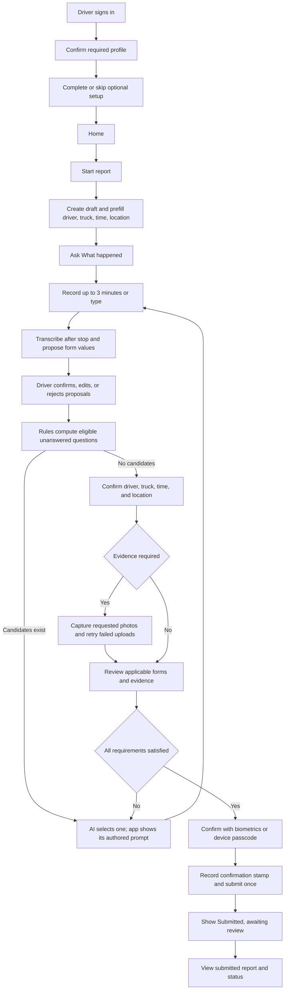

# JebelDAL MVP User Flows & Requirements

**Purpose:** Product flows, MVP scope, and acceptance checks for the driver-facing application. Technical contracts and system design are in [architecture.md](./architecture.md).

**Sources:** Hackathon brief, reviewed mobile mockups, the final [user-story workbook](./JebelAI_User_Stories%20(1).xlsx), and [architecture.md](./architecture.md).

**Current source of truth:** The workbook is v3 (final), dated 2026-11-18, with 48 stories: 31 Must, 11 Should, and 6 Could. It is driver-only. Complete the Must voice-to-submit workflow by Day 2; Day 3 is for polish, optional stories, and rehearsal. The 80% form-field functionality target remains a project goal.

## Confirmed product decisions

- The app is for the driver only. A successful report is “Submitted · awaiting review.” There is no manager/supervisor screen, approval decision, or change-request workflow in this MVP.
- The interview has 38 question nodes and 17 branch conditions. Ask only relevant unanswered questions, re-plan when answers change, and do not impose a fixed question cap.
- The flow is: profile/setup → Home → report draft and prefill → “What happened?” → applicable questions through Witnesses → “Is this right?” detail confirmation → evidence → Review & Sign → submitted confirmation.
- English is required. Spanish interview questions and transcription are a Day 3 Could.
- Voice recording is capped at three minutes per answer; transcription happens after stopping. The workbook targets a transcript within three seconds for a 30-second clip; this is a measured target, not a guarantee.
- Submission uses OS-local biometric authentication or device passcode and records a driver-name/time/device confirmation stamp. This is a UI confirmation, not identity verification or a legally authoritative signature.
- Auto, General Liability, and Workers' Comp demo forms use trimmed ACORD 2/3/4 fields; they are not validated carrier forms or legal advice.
- Documents, walk-around photos, Files browsing, short video, 3D truck view, post-capture photo checks, and extra language/context features follow their workbook Should/Could priorities; they are not allowed to delay the core flow.

## MVP scope and priorities

### Must by Day 2

- Invited driver email/password sign-in, profile confirmation, seeded Home, and report creation from Home or Incidents.
- Draft save/resume, local answer cache, and clear retry behavior; this is not full offline operation.
- Driver/truck/time/location prefill, with manual correction when a value is unavailable or wrong.
- Voice and text answers, transcript after recording stops, AI field proposals with evidence/confidence, and explicit driver confirmation.
- The full 38-node/17-branch question graph, conditional Auto/GL/WC selection, and missing-field checks. Rules determine eligible questions; AI chooses the next question from that set.
- Incident photo capture/upload, review of all applicable forms and evidence, missing-item blocking, and idempotent submission.
- At least 80% of defined form data fields with typed input, persistence, editing, validation, conditional behavior, and review display; remaining fields must still be visible and safely editable.

### Lower-priority work

| Priority / target | Stories and behavior |
|---|---|
| Should — Day 2 | Biometrics setup/sign-in, quick “none” replies, example answers, follow-up form tags, weather/daylight enrichment, severity and DOT flags, 2D truck-damage diagram. |
| Should — Day 3 | 3D truck-damage diagram with 2D fallback, photo classification/coaching, read-only view of submitted forms. |
| Could — Day 3 | Compliance documents, walk-around photos, Files screen, Spanish interview, contradiction warnings, 30-second incident video, and adding a form definition from a seed script. |

Optional setup may be skipped. Use seeded Home trip, driving-score, and pre-trip data and label it as demo data; do not imply a live fleet integration.

## Driver journey

### Flow details and recovery

1. **Sign in and profile:** No self-signup. An invited driver signs in, verifies/edits roster details, and completes the profile step. Biometrics, documents, and walk-around setup are optional at their planned priority.
2. **Start and prefill:** Create the draft before capturing answers. Prefill driver, assigned truck/plate, report-start time, and GPS location when available. Ask for missing values; allow manual correction.
3. **Voice interview:** Start with “What happened?” Show a waveform while recording and a transcript after stop. Allow up to three minutes per clip and provide text input if microphone access or transcription is unavailable. The 30-second-clip/three-second-transcript target is measured on physical devices.
4. **AI-assisted questions:** Show transcript and field suggestions with source/evidence and confidence. The driver accepts, corrects, rejects, or marks unknown. Only confirmed facts drive deterministic form activation and the gap checker. Rules compute the eligible unanswered question set, preserving safety priority; AI chooses one question from that set. Display the question's authored localized wording, not unconstrained model-generated questions. If the planner is invalid or unavailable, use configured rule order and visibly indicate the fallback. Re-plan after edits.
5. **Confirm details:** After Witnesses, show driver, truck, time, and location for confirmation. A narrative-provided time/place can override the initial derived value after driver confirmation. Location may show a map and accuracy when available; GPS is not mandatory.
6. **Evidence:** Show a shot list based on incident facts when damage or injury is reported. Capture/select photos and display upload state. Required photo counts block submit until satisfied. Optional video is limited to 30 seconds and is stored, not analyzed.
7. **Review and submit:** Show triggered Auto/GL/WC forms, values, source markers, evidence, and missing requirements. Permit edits. Check authoritative readiness for the current saved revision and show blockers before OS-local biometric/passcode confirmation; the submit transaction validates again. Save the driver/time/device stamp. A retry must not create a duplicate report.
8. **Interruption:** Keep answers in local cache and save each answer to the server when connected. On return, fetch the saved draft and turn states. Preserve unsynced input and offer retry; do not claim full offline queue support.
9. **After submit:** Lock the submitted report and show its reference/status. No manager approval or change-request workflow is implemented.

## Requirements and traceability

| ID | Requirement and acceptance outcome | Priority / source |
|---|---|---|
| R1 | Invited driver signs in by email/password, can reset password, and retains session; no self-signup. | Must — ST-01 |
| R2 | Driver confirms/edit roster profile; report creation uses seeded driver, vehicle, time, and optional location. | Must — ST-03, ST-09, ST-12 |
| R3 | Home offers one-tap report creation and seeded trip/score/pre-trip content; driver sees own drafts and submissions. | Must — ST-07, ST-09, ST-10 |
| R4 | Draft and answers survive navigation/restart; local cache and retry preserve input during network failures without promising full offline operation. | Must — ST-11, ST-20, NF-03 |
| R5 | Driver can answer by voice, text, or tap; see/edit transcript and replay prompts. Three-minute recording cap; target transcript within three seconds for a 30-second clip. | Must — ST-13–15 |
| R6 | Interview supports 38 nodes/17 conditions, back/skip/progress, quick replies, re-planning, no fixed question cap, and no repeated confirmed answers. Rules define eligible questions; AI selects the next one only from that set. | Must — ST-16–18, ST-42, D-08, D-20 |
| R7 | AI proposes only known fields with evidence quote/confidence, never silently overwrites confirmed values, and does not invent missing facts. Rules determine form activation, eligibility, requiredness, and completeness; AI recommends the next eligible question without changing its authored wording or rules. | Must — ST-23–25 |
| R8 | Auto/GL/WC activate from confirmed facts; repeatable form groups and field validation work. Severity, DOT-recordable and testing flags use isolated deterministic demo rules, not AI. | Must — ST-23–25, ST-28 |
| R9 | Driver confirms details after Witnesses; can correct driver/truck/time/location and manually enter location if GPS is unavailable. | Must — ST-12, ST-40 |
| R10 | Photo step shows answer-based shot guidance, upload progress/retry, and required-photo blockers. 2D truck damage zones share data with optional 3D view. | Must photos/2D — ST-19, ST-32; Should 3D/photo check — ST-33, ST-41 |
| R11 | Review shows every applicable form, values, provenance, evidence, and server-reported missing data before device confirmation; incomplete reports cannot submit. | Must — ST-36, ST-37 |
| R12 | Device biometric/passcode confirmation records driver name, time, and device; server checks readiness before confirmation and revalidates before creating exactly one submitted report. | Must — ST-38 |
| R13 | Submitted status is “Submitted · awaiting review”; no manager-facing queue, approval, or change-request workflow exists in this MVP. | Must — D-01, D-03 |
| R14 | Driver/organization data and private evidence are protected; provider keys remain server-side; permission/provider failures preserve saved work. | Must — NF-03, NF-04 |
| R15 | Optional documents, walk-around photos, Files, Spanish, 3D, photo check, contradiction check, video, and form-addition bonus follow the workbook's Day 2/Day 3 priority. | Should/Could — ST-02, ST-04–08, ST-22, ST-27, ST-29, ST-31, ST-33–34, ST-41 |

## Acceptance scenarios

- **Scenario A — bollard, no injury:** reversing collision with a fixed object activates Auto only; complete interview, review, confirmation, and submission.
- **Scenario B — rear-end on I-35 with police:** narrative proposes supported values; Auto and GL activate as applicable; test the no-cap path and target completion in about three to four minutes.
- **Scenario C — injury while unloading:** WC activates; injury/treatment branches appear; unresolved required answers/evidence block submission.
- **Recovery:** deny microphone permission, interrupt upload, and force a provider/network error separately; text fallback/retry works and saved answers remain. Invalid/unavailable question planning visibly falls back to rule order without bypassing a required safety question.
- **Access and submit:** another driver cannot access the report or media; submit with missing data is rejected; retry after success returns the same submitted report.

## Team notes

- The workbook is the detailed story/prioritization source. Its 48-story, driver-only scope supersedes older document assumptions about manager review and approval.
- Complete the Must flow by Day 2. Treat Day 3 work as optional polish/bonus; do not make it a prerequisite for the demo.
- Keep detailed API, data model, security design, and technical validation in [architecture.md](./architecture.md), rather than duplicating them here.
